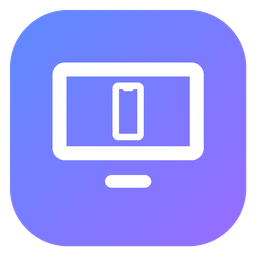

<p align="center">
  
</p>

<h1 align="center">Mirrorly</h1>

<p align="center">
  Mirror an iPhone, iPad or Android phone to your Windows PC, with sound.<br>
  Over Wi-Fi with AirPlay, or with a USB cable.
</p>

---

## Features

- **Screen mirroring** from iPhone and iPad, up to 4K and 60 fps
- **Android phones over USB**: plug the phone in and it mirrors, screen and sound
- **Android phones over Wi-Fi**: pair once with a QR code, then mirror without a cable
- **iPhone over USB**, through Personal Hotspot (same Screen Mirroring flow, no Wi-Fi needed)
- **Audio**, both while mirroring and for music-only AirPlay (ALAC, AAC, AAC-ELD)
- **Now Playing** view with artwork, title, artist and progress when streaming music
- **Portable**: a single `Mirrorly.exe` (about 14 MB) with no installer, runtime, Bonjour or iTunes needed
- **Themes**, picked at the bottom of Settings (the window and taskbar icon change with them):
  - **Default**: clean and quiet, follows Windows light/dark mode, frosted controls over the video
  - **Acid poster**: concrete-grey paper, giant acid-lime type, a cobalt block with pixel lettering, a halftone object and a live waveform
- **Volume** slider and mute on the PC, on top of the iPhone's own volume buttons

Tested with an iPhone on iOS 27.2 and Windows 11.

## Getting started

1. Download `Mirrorly.exe` from the [latest release](../../releases/latest) and run it.
2. When Windows Defender Firewall asks, click **Allow**. Tick both *Private* and *Public* networks.
3. Connect the iPhone and the PC to the **same network**.
4. On the iPhone, open **Control Center → Screen Mirroring** and choose your PC.

To stream music only, pick the PC from the AirPlay menu in Control Center or in any app.

## Mirroring with a cable

### Android

1. On the phone, turn on **USB debugging** (once):
   **Settings → About phone →** tap **Build number** 7 times, then **Settings → System → Developer options → USB debugging**.
   The menu names vary a little between brands.
2. Plug the phone into the PC. The first time, the phone asks *Allow USB debugging?*: tap **Allow**
   (tick *Always allow from this computer* so it doesn't ask again).
3. Mirroring starts on its own. Close it with ✕; click **Mirror** on the home screen to start again.

Sound comes through on Android 11 and later (the phone's own speaker goes quiet while mirroring).
Turn it off in **Settings → Cable (USB) → Android phones** if you don't want phones to mirror when plugged in.

### Android over Wi-Fi

Android 11 and later can do the same over Wi-Fi, through *Wireless debugging*:

1. Connect the phone to the same Wi-Fi network as the PC, and turn on Developer options (see above).
2. In Mirrorly, click **Pair over Wi-Fi** on the home screen (or **Settings → Android → Pair**). A QR code appears.
3. On the phone: **Settings → System → Developer options → Wireless debugging** → turn it on →
   **Pair device with QR code**, and scan the code. Mirroring starts as soon as the phone is paired.

You only pair once. Afterwards, whenever Wireless debugging is on, the phone shows up on the home screen
as *available over Wi-Fi*: click **Mirror**. Many phones turn Wireless debugging off when they change network
or restart; turn it back on from Developer options (or its Quick Settings tile).

### iPhone

iOS has no public way for a PC to receive the screen over USB, but AirPlay works over the cable:

1. On the iPhone, turn on **Settings → Personal Hotspot → Allow Others to Join**.
2. Plug it into the PC. Windows needs Apple's USB driver, which comes with the
   [Apple Devices](https://apps.microsoft.com/detail/9np83lwlpz9k) app (or iTunes).
3. Mirrorly shows *iPhone connected by cable*. Use **Control Center → Screen Mirroring** as usual.

## Controls

| Action | Shortcut |
| --- | --- |
| Toggle full screen | Double-click, <kbd>F11</kbd> or <kbd>Alt</kbd>+<kbd>Enter</kbd> |
| Leave full screen | <kbd>Esc</kbd> |
| Volume | Click the speaker button: a slider opens (click its speaker to mute). <kbd>↑</kbd> / <kbd>↓</kbd>, or the mouse wheel while it is open |
| Mute / unmute | <kbd>M</kbd> |
| Disconnect | ✕ button in the overlay |

Move the mouse while mirroring to show the controls.

## Settings

Click the gear icon:

| Setting | Description |
| --- | --- |
| Name | How the PC appears on your devices |
| Resolution | 720p, 1080p, 1440p or 4K: the highest quality the phone will send |
| Frame rate | 30 or 60 fps |
| Full screen on start | Go full screen as soon as mirroring begins |
| Play sound | Play the phone's sound on the PC |
| Windows Firewall | Lets Mirrorly through the firewall on all network types (asks for admin approval) |
| Android: USB cable | Mirror Android phones as soon as they are plugged in |
| Android: Wi-Fi | Show phones paired over Wi-Fi when their Wireless debugging is on |
| Android: Pair a phone over Wi-Fi | Shows the pairing QR code |
| Theme | Default or Acid poster; more can be added (see below) |

Settings are saved in `%APPDATA%\Mirrorly\settings.ini`.

## Updates

Mirrorly checks the project's GitHub Releases when it starts and every few hours. When a newer version is out,
it asks whether to update:

- **Update now** downloads the new `Mirrorly.exe`, checks it against the release's SHA-256 checksum, puts it in
  place of the running one and restarts. No browser, no installer.
- **Later** keeps the current version. A *New version* button stays on the home screen (and in
  **Settings → Updates**) for when you're ready.

Updates never interrupt mirroring: the question waits until the session ends. Mirrorly needs to be able to write
to its own folder to update itself (Downloads or Documents are fine; `C:\Program Files` is not).

## Troubleshooting

| Problem | Fix |
| --- | --- |
| The PC doesn't appear on the iPhone | Use **Settings → Windows Firewall → Allow**, and check both devices are on the same network. Guest Wi-Fi, client isolation and VPNs block AirPlay. |
| "Network discovery is blocked" | Another program has UDP port 5353 locked. Close other AirPlay receivers and restart Mirrorly. |
| Two receivers show up | Close any other AirPlay receiver app running on the PC. |
| Picture but no sound | Check **Settings → Play sound**, the mute button, the phone volume and the Windows output device. |
| Android phone plugged in, nothing happens | Check that USB debugging is on and the cable carries data (not charge-only). Some phones need their maker's USB driver on Windows (e.g. Samsung USB Driver). |
| Android: "Tap Allow on your phone" | Unlock the phone and accept the *Allow USB debugging?* prompt. |
| Android mirrors without sound | Sound needs Android 11 or later. |
| Paired Android phone doesn't show up over Wi-Fi | Check that Wireless debugging is still on and the phone is on the same network. Click **Settings → Windows Firewall → Allow** so the PC can see the phone. |
| Pairing waits forever | The phone and the PC must be on the same network (no guest Wi-Fi or client isolation). Turn Wireless debugging off and on, then scan again. |

Mirrorly writes a `Mirrorly.log` next to the exe (or in `%APPDATA%\Mirrorly`). Check it first when something goes wrong.

## How it works

```
iPhone ──mDNS──▶ discovery        (_airplay._tcp, _raop._tcp)
       ──RTSP──▶ pairing          (Ed25519 / X25519)
                 FairPlay setup   (session key exchange)
       ──TCP───▶ screen stream    (H.264, AES-128-CTR)
       ──UDP───▶ audio stream     (RTP, AAC-ELD / ALAC, AES-128-CBC)
                                    │
Android ─USB / Wi-Fi─▶ adb ─▶ scrcpy server on the phone (H.264 + PCM over an adb tunnel)
                                    │
                         FFmpeg decode → Direct2D (video) / waveOut (audio)
```

For Android, Mirrorly talks to the adb server directly (host protocol over TCP), pushes the
[scrcpy](https://github.com/Genymobile/scrcpy) server to the phone and reads its streams. If an adb server is
already running (Android Studio, for example) it is reused; otherwise Mirrorly starts the adb bundled in the exe
(unpacked to `%LOCALAPPDATA%\Mirrorly`) and stops it again on exit.

Over Wi-Fi, Mirrorly shows the QR code that Android's *Pair device with QR code* expects
(`WIFI:T:ADB;S:<name>;P:<password>;;`), finds the phone's `_adb-tls-pairing._tcp` and `_adb-tls-connect._tcp`
services with its own mDNS browser, and asks adb to pair and connect (`host:pair`, `host:connect`).

## Project layout

```
src/core/          AirPlay engine (portable C++17, also builds on Linux)
  mdns.*             mDNS / DNS-SD responder and browser
  receiver.*         RTSP server: /info, pairing, FairPlay, SETUP, TEARDOWN
  streams.*          mirroring video, RTP audio, NTP timing
  adb.*              adb host-protocol client (devices, push, forward, shell)
  android_mirror.*   Android mirroring over USB and Wi-Fi (scrcpy server streams, pairing)
  plist.*            binary property-list reader/writer
  crypto.*           SHA-512, AES, Ed25519, X25519
  native_media.c     FairPlay + FFmpeg decoding
src/app/           Windows app (Win32, Direct2D, DirectWrite, waveOut)
  app.h              app state, drawing toolkit and the Theme interface
  render.cpp         shared drawing, Settings layout, theme picker
  theme_default.cpp  Default theme
  theme_poster.cpp   Acid poster theme
  themes.cpp         theme registry
  android_usb.cpp    bundled adb, iPhone-over-USB detection
  updater.cpp        update check, download, checksum and self-replacement
tests/             simulated iPhone and Android phone for end-to-end tests
third_party/       playfair, Monocypher, tiny-AES, qrcodegen
res/               icon, manifest, resources
```

## Building

The build runs on Linux and cross-compiles for Windows with MinGW-w64.

```bash
# Ubuntu / Debian
sudo apt install build-essential nasm git gcc-mingw-w64-x86-64 g++-mingw-w64-x86-64

./build_ffmpeg.sh win        # minimal static FFmpeg 7.1 for Windows
./fetch_android_deps.sh      # adb + scrcpy server (checksums verified)
./build_windows.sh           # → out/win/Mirrorly.exe
```

### Adding a theme

1. Create `src/app/theme_<name>.cpp` with a class deriving from `Theme` (see `app.h`). It draws each screen
   (home, mirroring overlay, Now Playing), the Settings controls and a small preview for the picker.
2. Add its factory to `allThemes()` in `src/app/themes.cpp`. The picker shows themes in that order.
3. Optionally give it its own icon: add `N ICON "file.ico"` to `res/app.rc` and return `N` from `iconResource()`.

### Releases

Pushing a version tag builds `Mirrorly.exe` on GitHub Actions and publishes it as a GitHub Release:

```bash
git tag v1.0.0
git push origin v1.0.0
```

The version number in the tag is written into the app's About text and its Windows file properties.
Installed copies of Mirrorly find the new release by themselves and offer to update.
The release must contain `Mirrorly.exe` and `Mirrorly.exe.sha256` (the workflow uploads both).
To build locally with a version: `VERSION=1.0.0 ./build_windows.sh`.

### Tests

`tests/fake_iphone.cpp` acts like an iPhone. It runs discovery, pairing, the FairPlay handshake and SETUP, then streams encrypted H.264 video and audio, and checks what comes out.

```bash
./build_ffmpeg.sh linux
./build_linux.sh
./out/linux/fake_iphone /path/to/testmedia 2    # 2 = ALAC, 4 = AAC-LC
```

`tests/video_edges.cpp` checks that every pixel of every decoded frame is drawn, whatever the frame width.
iPhones send odd widths such as 1014 pixels in portrait:

```bash
ffmpeg -f lavfi -i testsrc2=size=1014x1440:rate=30 -frames:v 10 -c:v libx264 -bf 0 -f h264 odd.h264
./out/linux/video_edges odd.h264
```

`tests/android_usb.cpp` runs the USB engine against a fake adb server with a fake phone behind it
(plugging in, *Allow USB debugging*, mirroring, closing, re-plugging, phones without sound, pairing over Wi-Fi
with a QR code and reconnecting later):

```bash
./out/linux/android_usb /path/to/testmedia/video.h264
```

`tests/fake_adb.cpp` is the same fake phone as a separate program, to try the app's USB screens without a phone.

The test media folder for `fake_iphone` needs these files:
- `video.h264`: Annex-B H.264
- `alac_packets.bin` or `aac_packets.bin`: audio packets, each preceded by its 32-bit little-endian length

## Credits

- [UxPlay](https://github.com/FDH2/UxPlay) and [RPiPlay](https://github.com/FD-/RPiPlay): reference for the AirPlay protocol
- [scrcpy](https://github.com/Genymobile/scrcpy) (Apache 2.0): the server that runs on Android phones
- [Android platform tools](https://developer.android.com/tools/releases/platform-tools) (Apache 2.0): adb
- [QR Code generator](https://github.com/nayuki/QR-Code-generator) by Project Nayuki (MIT): the pairing QR code
- playfair (from shairplay): FairPlay handshake
- [FFmpeg](https://ffmpeg.org): H.264 and audio decoding
- [Monocypher](https://monocypher.org) and [tiny-AES-c](https://github.com/kokke/tiny-AES-c): cryptography

## License

Mirrorly is released under the [GNU General Public License v3.0](LICENSE.md), because it includes GPL-3 FairPlay code.

*AirPlay, iPhone and iPad are trademarks of Apple Inc. Android is a trademark of Google LLC.
This project is not affiliated with or endorsed by Apple or Google.*
